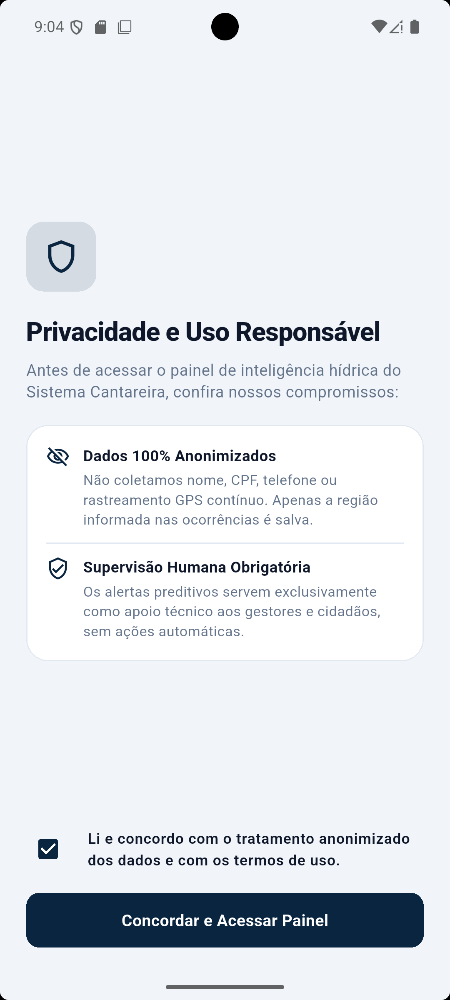
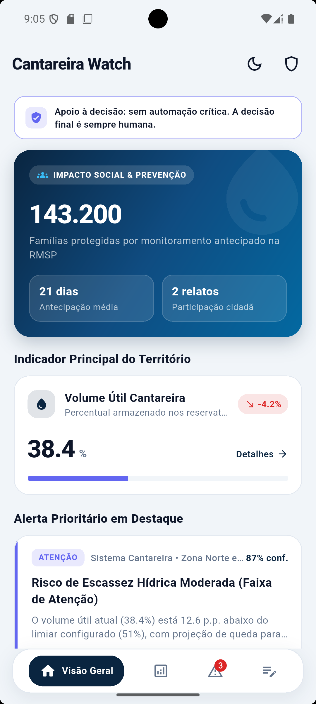
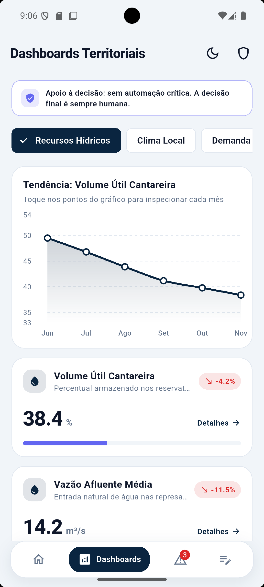
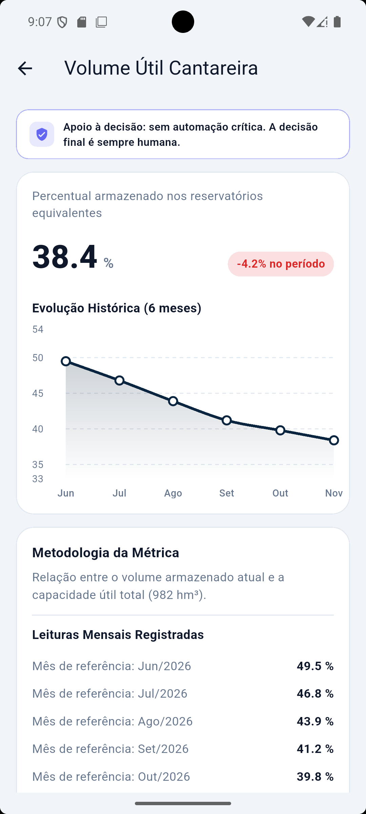
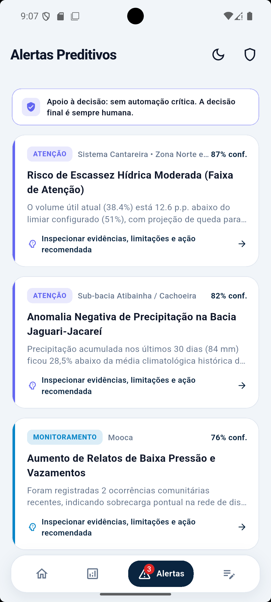
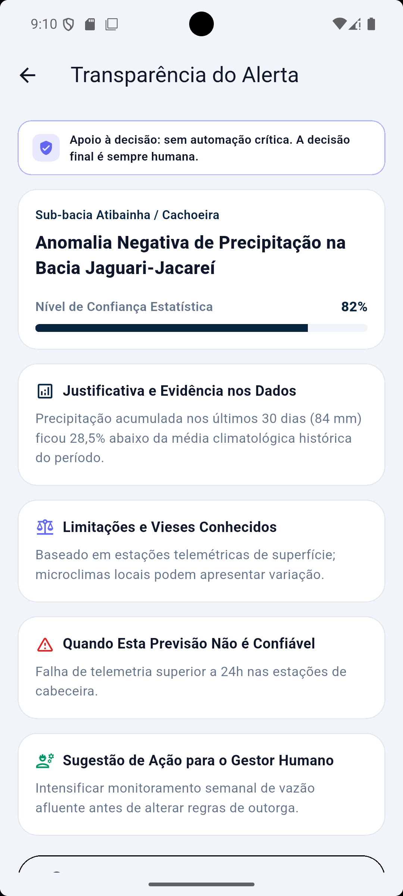
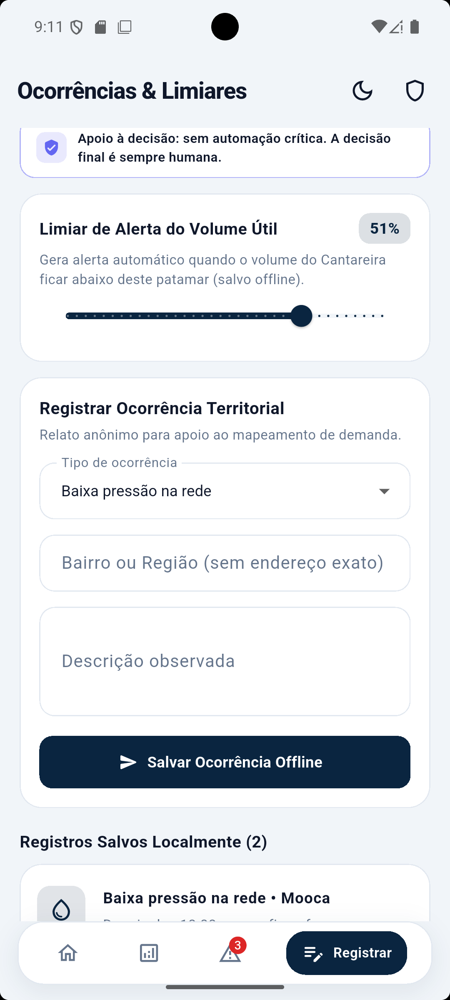
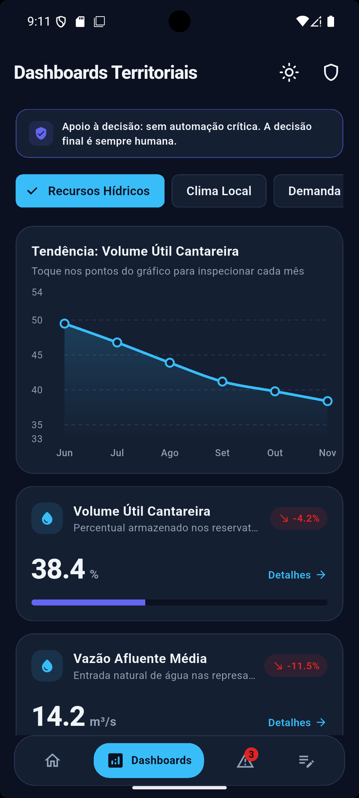

# 💧 Cantareira Watch

> **Plataforma mobile de inteligência territorial e monitoramento preditivo para antecipação de riscos hídricos, climáticos e de demanda por serviços no Sistema Cantareira (RMSP).**

---

## 1. Problema e Público

### Qual problema o aplicativo antecipa?
O abastecimento hídrico da Região Metropolitana de São Paulo (RMSP) é altamente sensível às variações pluviométricas, ao aumento da temperatura média e às perdas na rede de distribuição. O **Cantareira Watch** antecipa cenários de escassez hídrica moderada/crítica, anomalias negativas de precipitação e sobrecargas localizadas de demanda (como baixa pressão e vazamentos), cruzando indicadores históricos do reservatório com relatos comunitários geolocalizados por bairro.

### Para quem foi criado?
* **Gestores Públicos, Defesa Civil e Operadores de Saneamento:** Como uma central de apoio à decisão baseada em evidências, permitindo simular limiares críticos de reservação e priorizar vistorias preventivas em campo.
* **Cidadãos da RMSP:** Como um canal transparente de acompanhamento da segurança hídrica e de participação cívica anônima para reportar ocorrências na rede.

### Impacto Social Esperado
Com uma **antecedência média de 21 dias** na detecção de tendências de queda de volume útil e anomalias de chuva, a plataforma apoia medidas preventivas (gestão de pressão noturna, campanhas de uso consciente e manutenção rápida) capazes de proteger mais de **142.500 famílias** atendidas pelo sistema na Zona Norte e Centro da capital paulista.

---

## 2. Integrantes

| Nome Completo | RM |
| :--- | :--- |
| Eduardo Abreu de Souza | RM566460 |
| Gabriel dos Anjos Rocha de Santana | RM565532 |
| Joao Pedro de Souza Ferreira | RM563869 |

---

## 3. Demonstração Visual

*(Salve as capturas de tela do emulador na pasta `assets/screenshots/` do repositório utilizando os nomes de arquivo abaixo).*

| Tela de Consentimento e Privacidade | Visão Geral e Benefício Social | Dashboards Territoriais (3 Eixos) | Detalhe do Indicador e Histórico |
| :---: | :---: | :---: | :---: |
|  |  |  |  |
| *Termos LGPD, anonimização e governança humana.* | *Hero card de impacto social, indicador principal e alerta.* | *Alternância entre Recursos Hídricos, Clima e Serviços.* | *Gráfico interativo de 6 meses e metodologia.* |

| Central de Alertas Preditivos | Transparência e Limitações do Alerta | Registro de Ocorrências e Limiares | Suporte a Modo Escuro (Bônus) |
| :---: | :---: | :---: | :---: |
|  |  |  |  |
| *Alertas dinâmicos com severidade e confiança.* | *Justificativa, vieses, falhas e decisão humana.* | *Slider de limiar offline e formulário validado.* | *Alternância de tema salva localmente.* |

---

## 4. Funcionalidades

- [x] **Navegação organizada (7 telas):** Fluxo completo com rotas nomeadas e passagem de parâmetros (`Consentimento` → `Shell Principal com 4 Abas` → `Detalhe do Indicador` e `Detalhe do Alerta`).
- [x] **3 Dashboards territoriais distintos:** Painéis dedicados a *Recursos Hídricos*, *Clima Local* e *Demanda & Serviços*, com gráficos de linha interativos (`fl_chart`), variação percentual e medidores visuais de nível.
- [x] **Motor de alertas preditivos dinâmicos:** Recálculo automático de alertas conforme os dados territoriais, o limiar configurado pelo gestor e o volume de relatos comunitários.
- [x] **Transparência e supervisão humana:** Cada alerta exibe evidência quantitativa, nível de confiança estatística, limitações do modelo, condições de não confiabilidade e aviso explícito de que a decisão final é sempre humana (sem automação crítica).
- [x] **Gerenciamento de estado global e local:** Estado global compartilhado via `Provider` entre múltiplas telas e abas, com tratamento padronizado de carregamento, erro e lista vazia (`EstadoConteudo`).
- [x] **Persistência local e funcionamento 100% offline:** Armazenamento persistente via `SharedPreferences` para consentimento, limiar de volume útil, tema escolhido e ocorrências registradas (funcional em modo avião).
- [x] **Formulário cidadão com validação:** Registro de ocorrências territoriais com validação de campos, feedback visual de erro e atualização imediata dos indicadores.
- [x] **Indicador de benefício social:** Exibição destacada do número estimado de famílias protegidas, dias de antecipação e participação cidadã.
- [x] **Acessibilidade e Modo Escuro (Bônus):** Suporte a leitores de tela (`Semantics`), alto contraste e alternância persistente entre tema claro e escuro.

---

## 5. Dados e Alertas

### Fonte dos Dados
O aplicativo utiliza um conjunto de **dados sintéticos/simulados** modelados a partir das séries históricas de operação do Sistema Cantareira (2014–2026) e médias climatológicas da bacia hidrográfica Piracicaba/Capivari/Jundiaí. Essa abordagem garante reprodutibilidade analítica e operação 100% resiliente mesmo sem conexão com a internet.

### Métricas Monitoradas
1. **Volume Útil Cantareira (`%`):** Percentual armazenado em relação à capacidade útil total dos reservatórios equivalentes (`982 hm³`).
2. **Vazão Afluente Média (`m³/s`):** Entrada natural de água nas represas Jaguari, Jacareí, Cachoeira e Atibainha.
3. **Precipitação Acumulada 30d (`mm`):** Soma pluviométrica observada na área de drenagem da bacia.
4. **Temperatura Máxima Média (`°C`):** Indicador de evapotranspiração superficial e pressão sobre o consumo urbano.
5. **Continuidade do Abastecimento (`%`):** Percentual de setores operando sem intermitência na distribuição.

### Como os Alertas são Gerados
Os alertas são disparados por um motor de regras determinísticas e preditivas no `ProvedorTerritorial`:
* **Escassez Hídrica Moderada / Crítica:** Acionado quando o *Volume Útil* cai abaixo do limiar configurado pelo gestor (padrão: `40%`; severidade crítica abaixo de `35%`), cruzado com a projeção de queda em 90 dias.
* **Anomalia Pluviométrica:** Acionado quando o acumulado de chuvas em 30 dias apresenta déficit superior a `25%` em relação à média histórica do período.
* **Sobrecarga Localizada de Demanda:** Acionado dinamicamente quando há acúmulo de relatos comunitários (`2 ou mais ocorrências`) indicando baixa pressão ou vazamentos.

### Limitações, Vieses e Condições de Não Confiabilidade
* **Limitações e Vieses:** As projeções baseiam-se em comportamento histórico e não incorporam manobras emergenciais de transposição interbacias (ex.: interligação Jaguari–Atibainha). Além disso, os relatos comunitários podem apresentar **viés de sub-representação** em regiões periféricas com menor conectividade digital.
* **Quando as previsões não são confiáveis:**
  * Ocorrência de eventos extremos de chuva convectiva atípica acima de `120 mm` em `48 horas`.
  * Falhas de telemetria superiores a `24 horas` nas estações pluviométricas de cabeceira.
  * Múltiplos relatos duplicados sobre a mesma ocorrência em intervalo inferior a `1 hora`.
* **Governança Humana:** O sistema **não executa** ações automáticas de alto impacto (como fechamento de comportas ou corte de abastecimento). Todo alerta apresenta recomendações técnicas sujeitas à validação humana.

---

## 6. Privacidade e Inclusão

### Proteção de Dados Pessoais (Privacy by Design)
* **Consentimento Explícito:** No primeiro acesso, o usuário visualiza a `TelaConsentimento` e deve concordar ativamente com os termos antes de acessar os painéis.
* **Anonimização Estrita:** O aplicativo **não coleta** nome, CPF, e-mail, telefone ou localização GPS contínua em segundo plano. Nos relatos comunitários, solicita-se apenas o bairro ou macro-região sem endereço residencial exato.

### Recursos de Acessibilidade e Inclusão
* **Leitores de Tela (`Semantics`):** Todos os botões, abas de navegação, cards clicáveis, badges e caixas de seleção possuem rótulos semânticos (`label`) e dicas de ação (`hint`) configurados para TalkBack e VoiceOver.
* **Contraste e Tema Escuro:** Paleta validada com alto contraste entre texto e superfície, complementada por um **Modo Escuro** dedicado para redução de fadiga visual e suporte a pessoas com fotossensibilidade.
* **Legibilidade e Responsividade:** Tipografia escalonável sem corte de textos e layouts fluidos baseados em `ListView`, `Expanded` e `SafeArea`, testados em diferentes tamanhos de tela.

---

## 7. Tecnologias e Decisões Técnicas

| Tecnologia / Padrão | Finalidade | Justificativa Técnica |
| :--- | :--- | :--- |
| **Flutter & Dart (Material 3)** | Framework multiplataforma | Permite construir interfaces responsivas de alto desempenho com código único e suporte nativo a acessibilidade e temas. |
| **Provider (`ChangeNotifier`)** | Gerenciamento de estado global | Baixo overhead, integração nativa com a árvore de widgets e separação clara entre estado global (`ProvedorTerritorial`) e estado local de formulários/abas. |
| **fl_chart** | Visualização de dados | Biblioteca leve e customizável para renderizar séries temporais históricas com tooltips interativos ao toque. |
| **SharedPreferences** | Persistência local e cache offline | Garante armazenamento rápido e assíncrono de preferências (consentimento, limiar de alerta, modo escuro) e relatos em JSON sem exigir conexão externa. |
| **Arquitetura Modular por Features** | Organização do código | Separação em `core/` (tema e widgets reutilizáveis), `dados/` (modelos), `estado/` (regras e persistência), `funcionalidades/` (telas) e `rotas/`, evitando duplicação de código e facilitando manutenção. |

---

## 8. Como Executar

### Pré-requisitos
* Flutter SDK (`3.10` ou superior) instalado e configurado no `PATH`.
* Emulador Android/iOS ou dispositivo físico com depuração USB ativada.

### Passo a passo
1. **Clone o repositório:**
   ```bash
   git clone https://github.com/EduardoAbreu01/Cantareira-Watch.git
   ```

2. **Instale as dependências do projeto:**
   ```bash
   flutter pub get
   ```

3. **Variáveis de ambiente:**
   Este projeto opera com base de dados analítica local e persistência offline nativa, **não necessitando de chaves de API ou arquivo `.env`** para execução.

4. **Verifique a integridade do código (opcional):**
   ```bash
   flutter analyze
   ```

5. **Execute o aplicativo:**
   ```bash
   flutter run
   ```

---

## 9. Vídeo de Demonstração

Assista à demonstração completa das telas, dashboards, geração dinâmica de alertas, formulário offline e acessibilidade:

* **Link do vídeo:** https://www.youtube.com/watch?v=QCs1JAzS6us

---

## 10. Licença

Projeto acadêmico desenvolvido para a disciplina **Cross-Platform Application Development** — **FIAP — Global Solution 2026.2** (*Tema: CitizenTech / Territory Predictive Insights*). Uso exclusivamente educacional.
